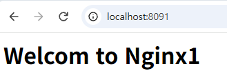
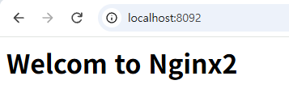
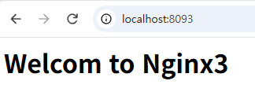
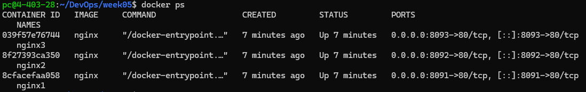

# 5주차 - Docker 시작하기 (w/ GitHub Issue)

## 학습 목표
- 하이퍼바이저(VM)와 컨테이너의 차이를 이해한다.
- 이미지와 컨테이너의 관계를 설명할 수 있다.
- `docker run, ps, logs, exec, stop, rm, images`와 주요 옵션을 사용한다.
- Docker 실습을 GitHub Issue로 정의하고 Issue → Branch → PR → Merge로 기록한다.

## 왜 Docker인가?
"내 컴퓨터에서는 되는데요?" 문제. 내 노트북은 Python 3.9, 친구는 3.13, 회사 서버는 2.7이면 같은 앱도 동작이 달라진다. 앱만 보내지 말고 **앱 + 라이브러리 + 설정을 통째로 묶어서** 보내자는 것이 컨테이너다.

| | VM (하이퍼바이저) | 컨테이너 |
|---|---|---|
| OS | VM마다 Guest OS 필요 | 호스트 커널 공유 |
| 시작 속도 | 느림 | 빠름 |
| 이미지 크기 | GB 단위 | MB 단위 |
| 격리 | 강한 격리 | 프로세스 수준 격리 (namespace, cgroup) |

| 구성 요소 | 설명 | 비유 |
|---|---|---|
| Image | 컨테이너를 만드는 읽기 전용 템플릿 | 붕어빵 틀 |
| Container | 이미지로 실행한 인스턴스 (N개 가능) | 붕어빵 |
| Registry | 이미지 저장소 (Docker Hub, ghcr.io) | 창고 |

> Mac의 Docker Desktop은 내부에 Linux VM을 두고 그 커널 위에서 컨테이너를 실행한다.

---

## 1. 설치 확인
```bash
docker --version                 # → docker-version.txt
docker info                      # → docker-info.txt
docker run --rm hello-world      # → docker-run-hello-world.txt
```
로컬에 `hello-world` 이미지가 없었는데도 실행됐다. 레지스트리에서 이미지를 자동으로 내려받아(pull) 컨테이너로 실행했기 때문이다.

## 2. nginx 컨테이너 실행
```bash
docker run -d -p 8080:80 --name web nginx
curl -I http://localhost:8080    # → curl-result.txt (HTTP/1.1 200 OK)
docker ps                        # → docker-ps.txt
```
| 옵션 | 의미 |
|---|---|
| `-d` | 백그라운드 실행 |
| `-p 8080:80` | 호스트 8080 → 컨테이너 80 연결 |
| `--name web` | 컨테이너 이름 지정 |

nginx를 설치하지 않았는데도 웹 서버가 떴다. nginx와 실행에 필요한 파일이 담긴 **이미지**를 받아 컨테이너로 실행했기 때문이다.

## 3. 주요 명령어
| 명령 | 하는 일 |
|---|---|
| `docker ps` / `docker ps -a` | 실행 중 / 전체(정지 포함) 컨테이너 |
| `docker images` | 내려받은 이미지 목록 |
| `docker logs -f web` | 로그 실시간 확인 |
| `docker stop` / `start` / `restart` | 정지 / 시작 / 재시작 |
| `docker rm -f web` | 컨테이너 강제 삭제 (이미지는 남음) |
| `docker exec -it web bash` | 실행 중인 컨테이너 안에서 셸 실행 |

- 컨테이너 안의 포트는 모두 80이어도 각자 격리되어 있어 충돌하지 않는다. 단, **호스트 포트**와 **컨테이너 이름**은 겹치면 오류가 난다.
- 컨테이너 안에서 `index.html`을 고쳐도, 컨테이너를 삭제하고 다시 만들면 원래대로 돌아간다. 변경 내용은 컨테이너의 쓰기 계층에만 있고 이미지(틀)는 바뀌지 않기 때문이다.

## 4. 서로 다른 파이썬 버전 실행 (test.py)
`match-case`는 Python 3.10부터 지원된다. 호스트에 파이썬을 따로 설치하지 않고 두 버전을 비교했다.
```bash
docker run --rm -v "$PWD:/app" -w /app python:3.9-slim  python test.py   # SyntaxError
docker run --rm -v "$PWD:/app" -w /app python:3.12-slim python test.py   # two
```
- `--rm`: 끝나면 컨테이너 자동 삭제 / `-v`: 현재 폴더를 컨테이너 `/app`에 연결 / `-w`: 작업 디렉터리 지정

---

## 5. 혼자 해보기: nginx 3개 띄우고 구분하기
```bash
docker run -d -p 8091:80 --name nginx1 nginx
docker run -d -p 8092:80 --name nginx2 nginx
docker run -d -p 8093:80 --name nginx3 nginx

# 각 컨테이너에 들어가 index.html을 구분되게 수정
docker exec -it nginx1 bash
echo "<h1>Welcome to nginx1</h1>" > /usr/share/nginx/html/index.html
exit
# nginx2, nginx3도 같은 방법으로 수정
```

### 브라우저 확인




### curl 결과
```bash
curl -I http://localhost:8091
curl -I http://localhost:8092
curl -I http://localhost:8093
```
```
HTTP/1.1 200 OK
Server: nginx/1.31.6
Date: Thu, 01 Oct 2026 03:13:42 GMT
Content-Type: text/html
Content-Length: 26
Last-Modified: Thu, 01 Oct 2026 03:09:05 GMT
Connection: keep-alive
ETag: "6abdced1-1a"
Accept-Ranges: bytes

HTTP/1.1 200 OK
Server: nginx/1.31.6
Date: Thu, 01 Oct 2026 03:13:51 GMT
Content-Type: text/html
Content-Length: 26
Last-Modified: Thu, 01 Oct 2026 03:09:24 GMT
Connection: keep-alive
ETag: "6abdcee4-1a"
Accept-Ranges: bytes

HTTP/1.1 200 OK
Server: nginx/1.31.6
Date: Thu, 01 Oct 2026 03:13:54 GMT
Content-Type: text/html
Content-Length: 26
Last-Modified: Thu, 01 Oct 2026 03:09:33 GMT
Connection: keep-alive
ETag: "6abdceed-1a"
Accept-Ranges: bytes
```
세 컨테이너 모두 `200 OK`로 응답했다. `Last-Modified` 시간(03:09:05 / 03:09:24 / 03:09:33)과 `ETag`가 서로 다른 것은 각 컨테이너의 `index.html`을 따로 수정했기 때문이다. `Content-Length`는 기본 nginx 페이지(896)가 아닌 26바이트로, 직접 바꾼 페이지가 응답한 것을 확인할 수 있다.

### docker ps


### 정리
```bash
docker rm -f nginx1 nginx2 nginx3 web
```

---

## 6. GitHub Issue로 실습 관리하기
이번 실습은 Issue로 할 일과 완료 조건을 먼저 정하고 진행했다.

| 단계 | 한 일 |
|---|---|
| Issue | #3 `5주차 Docker 실행 환경 확인 및 nginx 실행` 생성, 완료 조건 8개 체크박스 작성 |
| Branch | `git switch -c "docs/issue-${ISSUE_NO}-docker-start"` |
| 기록 | 실행 결과를 txt 파일과 README.md에 저장, 완료한 항목 체크 |
| Commit/Push | `git commit -m "5주차: Docker 실행 환경 및 nginx 확인 (#${ISSUE_NO})"` |
| PR | `gh pr create`, 본문에 `Close #이슈번호` |
| Merge | PR #4를 squash merge |

### 겪은 문제
커밋 메시지가 `5주차: ... (#)`로 이슈 번호 없이 올라갔다. `ISSUE_NO=3` 변수를 지정하지 않은(또는 새 터미널에서 사라진) 상태로 명령을 실행해 `${ISSUE_NO}`가 빈 값이 되었기 때문이다. 그 결과 PR 본문의 `Close #`도 이슈와 연결되지 않아 Issue가 자동으로 닫히지 않았고, 웹에서 직접 닫았다. 셸 변수는 해당 터미널에서만 유지된다는 것과, PR을 올리기 전에 `echo $ISSUE_NO`로 값을 확인해야 한다는 것을 배웠다.

---

## 핵심 정리
- 컨테이너는 앱과 실행 환경을 함께 묶어 실행한다.
- 이미지(붕어빵 틀) → `docker run` → 컨테이너(붕어빵)
- `-p` 포트 연결 / `-d` 백그라운드 / `-e` 환경 변수 / `--rm` 일회용
- 컨테이너를 삭제하면 쓰기 계층의 변경 내용도 함께 사라진다.
- DevOps 흐름: Issue → Branch → 기록 → Commit/Push → PR → Merge → Issue Close
