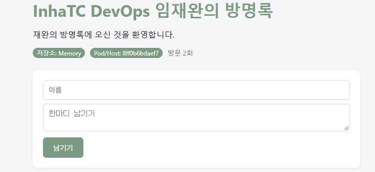

# 6주차 - Dockerfile과 이미지 배포

## 내 이미지 주소
```
ghcr.io/littleneogul/guestbook:v2
```
```bash
docker run -d -p 8080:5000 --name gbv2 ghcr.io/littleneogul/guestbook:v2
```

## 학습 목표
- Dockerfile의 주요 명령어(FROM, WORKDIR, COPY, RUN, ENV, EXPOSE, CMD)를 설명할 수 있다.
- 레이어 캐시의 원리와 명령어 순서의 중요성을 이해한다.
- 앱을 이미지로 만들어 ghcr.io에 올리고, 친구의 이미지를 받아 실행한다.

## 지난주에 남은 질문
5주차에는 컨테이너 안에서 고친 내용이 컨테이너를 지우면 사라졌다. 이번 주에는 변경 사항을 **이미지 자체에 구워 넣는** 방법, 즉 Dockerfile로 나만의 붕어빵 틀을 만들었다.

```
[내 코드] + [Dockerfile] → docker build → [내 이미지] → docker push → [ghcr.io]
                                                          누구나 docker pull → run
```

이미지 주소는 `레지스트리/사용자/이미지:태그` 구조이다. 태그를 생략하면 `latest`를 찾으며, 레지스트리를 생략하면 Docker Hub에서 찾는다.

---

## 1. Dockerfile 한 줄씩 설명
`guestbook_week06/Dockerfile`

```dockerfile
FROM python:3.12-slim
```
기반 이미지. 파이썬 3.12가 설치된 가벼운(slim) 리눅스에서 시작한다. 모든 이미지는 FROM으로 시작한다.

```dockerfile
WORKDIR /app
```
이미지 안의 작업 폴더를 `/app`으로 정한다. 폴더가 없으면 만들고, 이후 명령은 여기서 실행된다. 셸의 `cd`와 비슷하다.

```dockerfile
COPY requirements.txt .
RUN pip install --no-cache-dir -r requirements.txt
```
라이브러리 목록 파일만 **먼저** 복사해서 Flask, redis를 설치한다. RUN은 이미지를 **만들 때 한 번** 실행되고, 설치 결과가 이미지에 남는다. 코드보다 라이브러리 목록이 덜 바뀌기 때문에 먼저 두면 캐시를 재사용할 수 있다.

```dockerfile
COPY . .
```
나머지 소스 코드(app.py, templates 등)를 이미지 안으로 복사한다. `.dockerignore`에 적힌 파일은 제외된다.

```dockerfile
RUN useradd -m appuser
USER appuser
```
일반 사용자 `appuser`를 만들고 그 사용자로 앱을 실행한다. 컨테이너 안에서 root로 실행하면 보안상 위험하기 때문이다.

```dockerfile
ENV APP_TITLE="황현우 DevOps 방명록" \
    THEME_COLOR="#50C878"
```
환경 변수 기본값을 이미지에 넣는다. 제목을 내 이름으로, 테마 색을 에메랄드 그린으로 바꿨다. `docker run -e`로 덮어쓸 수 있다.

```dockerfile
EXPOSE 5000
```
"이 컨테이너는 5000번 포트를 쓴다"는 **문서(메모)**일 뿐 실제로 포트를 열지는 않는다. 바깥에서 접속하려면 `-p 8080:5000`이 필요하다.

```dockerfile
CMD ["python", "app.py"]
```
컨테이너가 **시작될 때마다** 실행할 명령이다. 여러 개 쓰면 마지막 것만 적용되며, 배열 형태로 쓰는 것을 권장한다.

| 헷갈리는 것 | 차이 |
|---|---|
| RUN vs CMD | RUN = 이미지 만들 때 한 번 / CMD = 컨테이너 켤 때마다 |
| EXPOSE vs -p | EXPOSE = 메모 / `-p` = 실제 포트 연결 |

---

## 2. 빌드 캐시 확인
```bash
cd guestbook_week06
docker build -t guestbook:v1 .
# templates/index.html 문구를 "첫 글의 주인공이 되어주세요!"로 수정
docker build -t guestbook:v1.2 .
```
```
=> CACHED [2/6] WORKDIR /app
=> CACHED [3/6] COPY requirements.txt .
=> CACHED [4/6] RUN pip install --no-cache-dir -r requirements.txt
=> [5/6] COPY . .
=> [6/6] RUN useradd -m appuser
```
코드(템플릿)만 바꿨기 때문에 `requirements.txt` 복사와 `pip install`은 **CACHED**로 재사용되고, `COPY . .`부터 다시 빌드됐다. 한 레이어가 바뀌면 그 아래 레이어는 전부 다시 만들어진다.

### 나쁜 예와 비교 (Dockerfile.bad)
```dockerfile
FROM python:3.12-slim
WORKDIR /app
COPY . .                              # 코드를 먼저 통째로 복사
RUN pip install -r requirements.txt   # 코드 한 줄만 바뀌어도 매번 다시 설치
CMD ["python", "app.py"]
```
`app.py`에 주석 한 줄만 추가해도 `pip install`이 처음부터 다시 실행됐다. **자주 바뀌는 것은 뒤에** 두는 것이 핵심이다.

---

## 3. 배포: build → tag → push
```bash
gh auth token | docker login ghcr.io -u littleneogul --password-stdin
docker build -t guestbook:v2 .
docker tag guestbook:v2 ghcr.io/littleneogul/guestbook:v2
docker push ghcr.io/littleneogul/guestbook:v2
```
패키지 설정에서 visibility를 **Public**으로 바꿔야 친구가 받을 수 있다.

> Apple Silicon Mac(arm64)에서 만든 이미지는 x86 PC(amd64)에서 느리거나 실행되지 않을 수 있다. 양쪽을 모두 지원하려면 `docker buildx build --platform linux/amd64,linux/arm64 ... --push .`로 빌드한다.

## 4. 친구 이미지 실행
```bash
docker run -d -p 9090:5000 --name friend ghcr.io/친구아이디/guestbook:v1
```


친구의 소스 코드도 없고, Flask도 설치하지 않았고, 파이썬 버전도 신경 쓰지 않았는데 내 컴퓨터에서 그대로 실행됐다. 다만 내가 남긴 글은 친구 컴퓨터에서 보이지 않는다. 이미지는 **프로그램**을 공유할 뿐 **데이터**까지 공유하지는 않기 때문이다.

---

## 5. 설정을 넣는 세 가지 방법
우선순위: **코드 기본값 < Dockerfile ENV < docker run -e**

| 방법 | 언제 확정되나 | 바꾸려면 | 예 |
|---|---|---|---|
| `app.py` 기본값 | 코드 작성 시 | 코드 수정 + 재빌드 | `"DevOps 방명록"`, 빨간색 |
| Dockerfile `ENV` | 이미지 빌드 시 | 재빌드 | `"황현우 DevOps 방명록"`, `#50C878` |
| `docker run -e` | 컨테이너 실행 시 | 컨테이너만 다시 실행 | `-e THEME_COLOR="#C6A15B"` |

```bash
docker run -d -p 8081:5000 --name gbv2 -e THEME_COLOR="#C6A15B" ghcr.io/littleneogul/guestbook:v2
```
이미지에 구운 초록색(`#50C878`)이 아니라 실행할 때 주입한 금색(`#C6A15B`)이 적용됐다. 이미지를 다시 만들지 않고도 바깥에서 설정만 바꿀 수 있다.

---

## 생각해보기
방명록에 글을 남기고 `docker restart`를 하면 **테마 색은 그대로인데 글은 사라진다.** 색은 이미지(ENV)에 들어 있지만, 글은 앱 프로세스의 메모리에 저장되기 때문이다. 재시작하면 프로세스가 새로 시작되어 데이터가 사라진다. → 7주차에 Redis와 볼륨으로 해결

## 핵심 정리
- Dockerfile = 이미지를 만드는 방법을 코드로 적은 레시피 (Infrastructure as Code)
- RUN = 빌드할 때 / CMD = 컨테이너 켤 때 / EXPOSE = 포트 메모
- 레이어 캐시: 자주 바뀌는 것은 뒤로
- 배포 흐름: build → tag → push → (친구) pull → run
- `git tag week06`으로 6주차 시점을 표시해 두면 나중에 비교하거나 되돌릴 수 있다.
