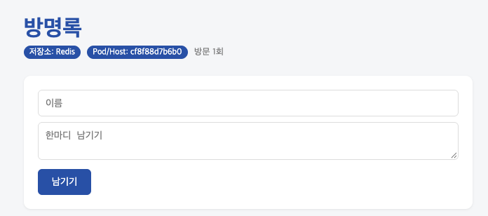
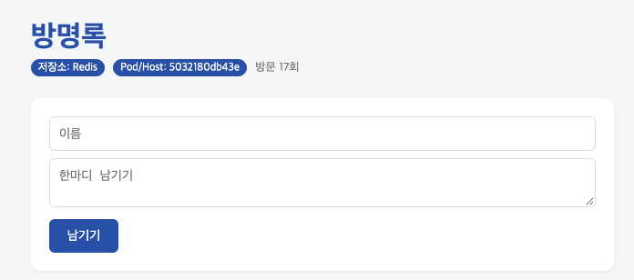

# 7주차 - 도커 컴포즈 (web + redis + nginx)

## 학습 목표
- 여러 컨테이너(web, redis, nginx)를 `compose.yaml` 파일 하나로 관리한다.
- 서비스 이름으로 서로를 찾는 컴포즈 네트워크(내부 DNS)를 이해한다.
- `.env`로 비밀번호를 분리하고, healthcheck로 "준비 완료"를 확인한다.
- `--scale web=3`과 nginx로 요청을 여러 web 컨테이너에 나눈다.

## 전체 구조
```
브라우저 :8080
      │
  [ nginx ]          요청을 받아 web들에게 분배 (리버스 프록시)
      │
 ┌────┼────┐
[web][web][web]      --scale web=3, healthcheck(/readyz)
      │
  [ redis ]          데이터 저장, 비밀번호는 .env에서
```

## 실행 방법
```bash
cd guestbook
cp .env.example .env          # .env 안의 비밀번호를 내 값으로 수정
docker compose config --quiet && echo OK
docker compose up -d --build --scale web=3
# → http://localhost:8080
```

---

## 1. docker compose ps 결과 (healthy 포함)

```
NAME                       IMAGE                  COMMAND                   SERVICE   CREATED              STATUS                        PORTS
guestbook_week07-nginx-1   nginx:alpine           "/docker-entrypoint.…"   nginx     About a minute ago   Up About a minute             0.0.0.0:8080->80/tcp, [::]:8080->80/tcp
guestbook_week07-redis-1   redis:7-alpine         "docker-entrypoint.s…"   redis     About a minute ago   Up About a minute (healthy)   6379/tcp
guestbook_week07-web-1     guestbook_week07-web   "python app.py"           web       About a minute ago   Up About a minute (healthy)   5000/tcp
guestbook_week07-web-2     guestbook_week07-web   "python app.py"           web       About a minute ago   Up About a minute (healthy)   5000/tcp
guestbook_week07-web-3     guestbook_week07-web   "python app.py"           web       About a minute ago   Up About a minute (healthy)   5000/tcp
```

redis와 web 3개가 모두 `Up ... (healthy)` 상태이고, 바깥으로 포트가 열린 것은 nginx(`0.0.0.0:8080->80/tcp`) 하나뿐이다. web은 `expose`만 했기 때문에 외부에서 직접 접근할 수 없고 nginx를 통해서만 들어온다.

## 2. scale 후 호스트명이 바뀌는 화면

```bash
docker compose up -d --scale web=3
```

http://localhost:8080 에서 새로고침을 반복하며 화면을 캡처했다.

| 캡처 | Pod/Host (응답한 컨테이너) | 방문 수 |
|---|---|---|
| 1 | `cf8f88d7b6b0` | 1회 |
| 2 | `1ed94bfa253a` | 2회 |
| 3 | `5032180db43e` | 17회 |





브라우저를 새로고침할 때마다 화면의 `Pod/Host` 값이 바뀌었다. 이 값은 컨테이너의 호스트명(= 컨테이너 ID)으로, 서로 다른 web 컨테이너 3개가 번갈아 응답했다는 뜻이다. nginx가 요청을 web 3개에 돌아가며 보내기 때문이다.

반면 방문 수는 어느 컨테이너가 응답하든 1 → 2 → 17로 이어서 올라갔고, 방명록 글도 똑같이 보였다. 데이터가 각 web 안이 아니라 하나의 redis에 저장되어 있기 때문이다. (앱은 여러 개, DB는 한 개)

## 3. down 후 up vs down -v 후 up

| 명령 | 지워지는 것 | 다시 up 했을 때 방명록 글 |
|---|---|---|
| `docker compose down` | 컨테이너, 네트워크 | **남아 있음** |
| `docker compose down -v` | 컨테이너, 네트워크, **볼륨(redis-data)** | **모두 사라짐** |

redis는 `--appendonly yes` 옵션으로 데이터를 `/data`에 기록하고, 이 경로가 `redis-data` 볼륨에 연결되어 있다. `down`은 컨테이너만 지우기 때문에 볼륨이 남아 다시 `up` 하면 글이 그대로 있다. `down -v`는 볼륨까지 지우므로 데이터가 완전히 삭제된다. 즉 **컨테이너는 일회용, 데이터는 볼륨에** 있다.

## 4. .env를 Git에 올리지 않는 이유

- `.env`에는 Redis 비밀번호 같은 **실제 비밀 값**이 들어 있다.
- 공개 저장소에 올리면 누구나 볼 수 있고, 한 번 커밋되면 지워도 **커밋 기록에 계속 남는다.**
- 그래서 `.env`는 `.gitignore`로 제외하고, 어떤 값이 필요한지만 알려주는 `.env.example`(값 없는 양식)만 올린다.
- `compose.yaml`에는 값 대신 `${REDIS_PASSWORD}` 빈칸만 적어두고, 실행할 때 각자의 `.env` 값이 채워진다.
- `.dockerignore`에도 `.env`가 있어 이미지 안에도 들어가지 않는다.

| Git에 올리는 것 | 내 컴퓨터에만 두는 것 |
|---|---|
| `compose.yaml`, `nginx.conf`, `.env.example` | `.env` |

---

## 실습하다 막혔던 점
처음 `docker compose up -d`를 했을 때 `container guestbook-redis-1 is unhealthy` 오류가 났다. `.env` 파일을 만들지 않아 `REDIS_PASSWORD`가 빈 값이 되었고, redis healthcheck(`redis-cli -a ${REDIS_PASSWORD} ping`)가 계속 실패했기 때문이다. web은 `condition: service_healthy`로 redis가 healthy가 될 때까지 기다리므로 같이 실행되지 않았다. `.env`를 만들고 `docker compose config`로 값이 들어간 것을 확인한 뒤 해결했다.

## 핵심 정리
- 컨테이너 하나 = 역할 하나 (앱과 DB 분리)
- 서비스 이름이 곧 주소 (`REDIS_HOST: "redis"`)
- `depends_on`은 시작 순서만, `condition: service_healthy`는 준비 완료까지 기다림
- `ports`는 바깥에 공개, `expose`는 내부에서만 사용
- `docker compose config`로 띄우기 전에 미리 검사
